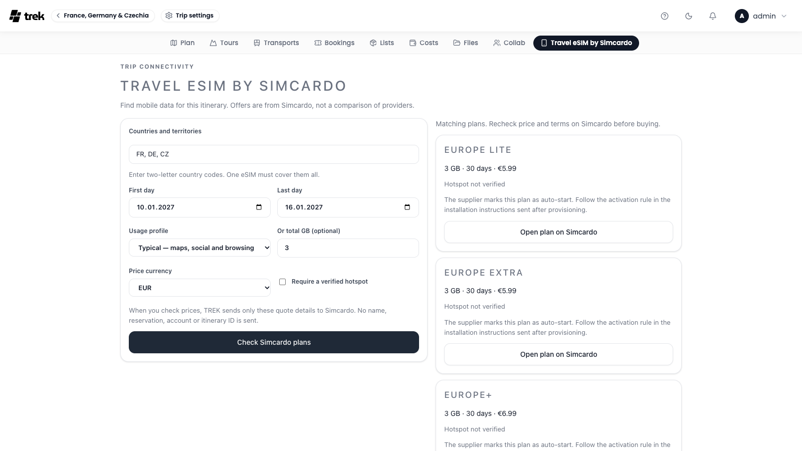

# Travel eSIM by Simcardo

An optional **trip tab** for self-hosted TREK. It prefills the itinerary dates, then checks live data plans supplied by Simcardo when the traveler asks. Enter the itinerary's two-letter country codes (for example `FR, DE, CZ`), choose data or a usage profile, and optionally require verified tethering.

## What it does

- Calls the public [Simcardo travel eSIM MCP](https://simcardo.com/en/travel-esim-mcp). No Simcardo key is required.
- Returns up to three current offers for **one eSIM covering all selected countries**. A shorter or unverified offer is not substituted.
- Opens the exact SKU on Simcardo. No purchase or reservation is made in TREK. This plugin offers products from one provider, not a market-wide comparison.

## Screenshots

## Setup

1. Use a compatible self-hosted TREK version (5.1.4 through 5.1.x) with its plugin runtime enabled.
2. Download `plugin.zip` from [Releases](https://github.com/karmazin/simcardo-connectivity/releases). Under **Admin → Plugins**, upload the ZIP and activate it after reviewing the two grants. Sideloading shows an unverified-source notice in TREK; use the official registry once available if you prefer its checks.
3. Open a trip and select **Travel eSIM by Simcardo**. Review dates and currencies, enter country codes, and press **Check Simcardo plans**.

## Permissions and data

| Grant | Why |
| --- | --- |
| `db:read:trips` | Prefills dates and supported currency from the open trip. TREK enforces trip membership. No itinerary write permission is requested. |
| `http:outbound:simcardo.com` | Sends the quote form to one fixed HTTPS endpoint only after an explicit click. |

The quote sends selected countries, dates, locale, currency, data needs and hotspot preference. It does **not** send account or trip IDs, names, reservations, notes or traveler details. There are no background jobs, cookies or pixels in the plugin. Product links retain the exact SKU and include a generic `trek_itinerary` attribution tag, never a user or trip identifier. Normal Simcardo website privacy settings apply after opening a plan.

## Development

`npm ci`, `npm test`, `npm run validate`, then `npm run pack`. The SDK is injected by TREK at runtime; the package vendors no dependencies.

An independent third-party plugin maintained by Simcardo, not a partnership or endorsement by TREK. MIT licensed.
